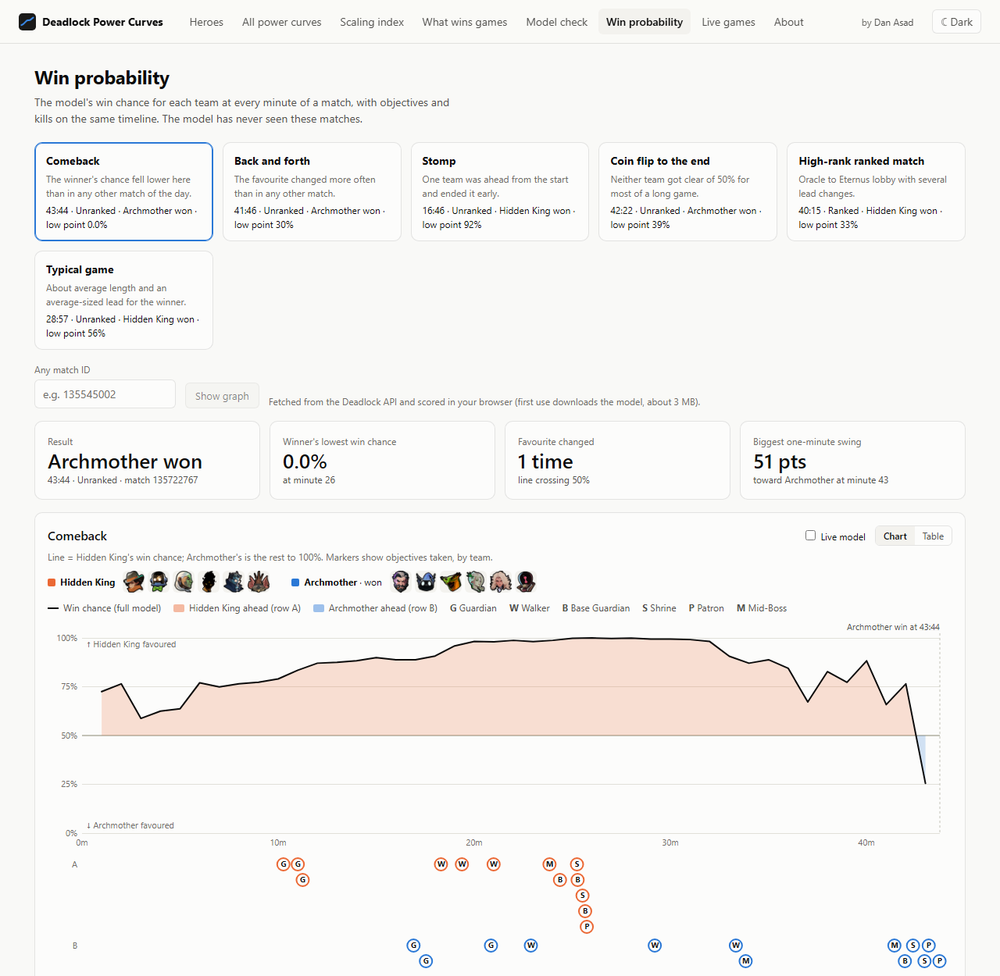
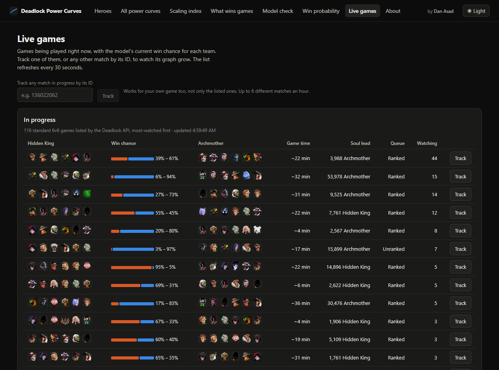
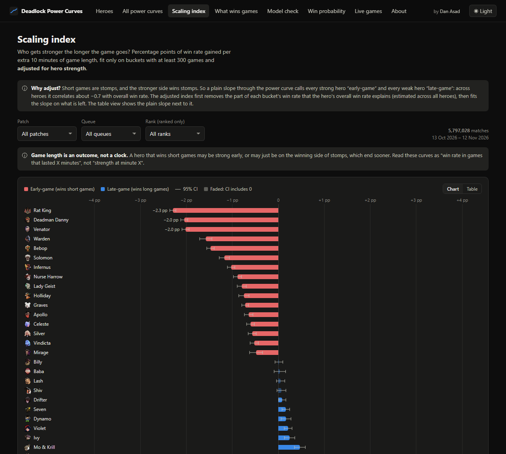
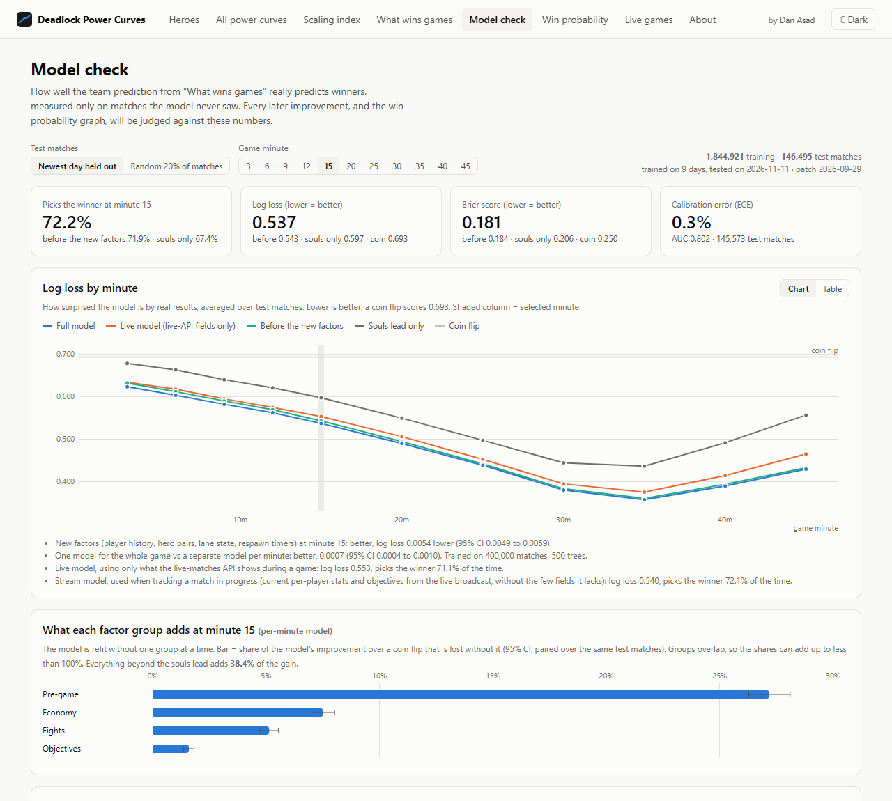

# Deadlock Power Curves: who scales, and who's winning

**[Open the live site →](https://danasad.github.io/Deadlock-Power-Curves/)**

A data science portfolio project by **Dan Asad** · [LinkedIn](https://www.linkedin.com/in/danasad/) · [GitHub](https://github.com/DanAsad)

Deadlock is Valve's 6v6 hero shooter. This project asks two questions of millions
of public matches:

1. **Which heroes get stronger as a game goes on?** Win rate by game length for
   every hero, with 95% confidence intervals, and a scaling index adjusted so
   that strong heroes winning stomps doesn't count as "early-game".
2. **Who is going to win, from any moment in a game?** A win-probability model
   that draws a minute-by-minute graph for any finished match, and follows any
   match being played right now.

Data from the free [Deadlock API](https://deadlock-api.com) public data lake.
Not affiliated with Valve.

## Headline results

| | |
|---|---|
| Matches analysed (power curves, 30 days) | **5.6 million** (matches where someone left are excluded) |
| Win model trained on / tested on | 1.8M matches / 146k matches from a later day it never saw |
| Winner picked correctly | **65%** at minute 3 · **72%** at minute 15 · **82%** at minute 30 |
| Calibration error | **0.2%**: when the model says 70%, that side wins about 70% of the time |
| Biggest pre-game factors | the draft (hero strength, pairs that work together, counters) and the players' 30-day history |
| Browser vs Python | the in-browser model matches the Python pipeline to 5 decimal places |

Findings along the way:

- **Game length is an outcome, not a clock.** A plain "win rate vs game length"
  slope correlates −0.80 with a hero's overall win rate, because the stronger
  side wins stomps and stomps end early. Adjusting for hero strength brings that
  to 0.01.
- **Short games are mostly someone leaving.** 86% of games under 20 minutes
  have a player who abandoned, and that team wins 0.2% of them. Those matches
  (10.5% of all) are left out of the power curves; the odd jump between the
  under-20 and 20–25 minute buckets, which tracked hero strength (r = 0.88),
  disappears (r = 0.08).
- **Interpolating stats between snapshots leaked the future.** The model scored
  better just after a snapshot than at it; carrying stats forward with a
  "how old is this" input fixed it.
- **More models aren't always better.** Separate models per queue and per rank
  bracket were tested against the one shared model and none beat it; the
  narrower the group, the worse its own model did.

## Screenshots

| Win probability for a finished match | Live games and match tracking |
|---|---|
|  |  |
| **Scaling index, adjusted for hero strength** | **Model check: every result on held-out data** |
|  |  |

## How it works

```
Deadlock API data lake ──DuckDB──▶ pipeline/ (Python) ──▶ small tables + exported models in data/
   (700 GB of Parquet)            power curves, factors,       │
                                  win model, evaluation        ├──▶ api/ (FastAPI, local)
                                                               └──▶ GitHub Pages (static JSON)
                                                                        │
Deadlock API (live) ─────────────────────────────────────────────▶ web/ (React + TypeScript)
   match data, live broadcasts                                      runs the model in the browser
```

- **Pipeline** (`pipeline/`): queries the lake one day at a time with DuckDB,
  builds per-minute team-difference rows (souls, kills, objectives, draft,
  player history), and precomputes every table the site shows.
- **Model** (`pipeline/model.py`): one gradient-boosted model over all minutes,
  with a per-minute logistic score as an input, both teams treated the same,
  and isotonic recalibration. Tested by training on earlier days and scoring the
  newest one, split by match.
- **Site** (`web/`): React + TypeScript with hand-made SVG charts. There is no
  server: the models are exported to JSON and run in the visitor's browser,
  for match lookups and live tracking.
- **Deploy**: every push runs the parity test, builds the site and publishes it
  to GitHub Pages (`.github/workflows/pages.yml`).

**Stack:** Python (pandas, DuckDB, scikit-learn, FastAPI) · TypeScript, React,
Vite · GitHub Actions, GitHub Pages.

The rest of this README is the detailed write-up: method, every model
experiment, and how to run it yourself.

## Layout

```
pipeline/   Python jobs: query the lake with DuckDB → small tables in data/
api/        FastAPI: serves data/ with filter params (+ the built frontend)
web/        React + Vite + TypeScript frontend
data/       precomputed tables (power_curves.parquet, scaling_index.parquet, heroes.json, meta.json)
schema.md   data lake tables and columns, with findings
```

## Quick start

```bash
python -m venv .venv && .venv\Scripts\activate      # macOS/Linux: source .venv/bin/activate
pip install -r requirements.txt
cd web && npm install && cd ..

python -m pipeline.build --demo        # synthetic data, offline, ~5 s
# or: python -m pipeline.build --days 30   (real matches, ~15 min first time)
python -m pipeline.win_factors --days 2   # "What wins games" tab (or --demo), ~2 min

uvicorn api.main:app --reload --port 8000   # terminal 1
cd web && npm run dev                       # terminal 2 → http://localhost:5173
```

Production-style: `cd web && npm run build`, then `uvicorn api.main:app` serves
the app and the API together on one port.

Tests: `python -m pytest pipeline api`. The demo test plants known per-hero
scaling slopes in synthetic matches and checks the scaling index recovers them
(correlation > 0.95).

## Online version (GitHub Pages)

Live at https://danasad.github.io/Deadlock-Power-Curves/. GitHub Pages has no
backend, so on every push to `main` the workflow in `.github/workflows/pages.yml`
builds the frontend in static mode (`VITE_STATIC=1`) and runs
`python -m api.export_static`, which writes every API response as a JSON file
from the committed tables in `data/`. Match lookups and live games are scored in
the visitor's browser (see Win probability). To refresh the numbers online:
rerun the pipeline locally (and `python -m pipeline.export_web` after
retraining), commit `data/`, push.

## Data

- Lake: `https://data.deadlock-api.com/v1/catalog.ducklake` (DuckLake, read-only,
  hourly). Connection in `pipeline/lake.py`. If it breaks, copy the current
  snippet from <https://deadlock-api.com/data-dumps>.
- Schema: `python -m pipeline.explore_schema` regenerates `schema.md`.
- The pull runs one UTC day at a time (timeout + retries per day) and caches
  each day's aggregated counts in `data/cache/`. Reruns only fetch new days and
  the last two (still filling in); `--refresh` refetches everything. One big
  30-day query over HTTP hung on a stalled connection, hence the chunking.
- One table, `match_player`, holds one row per player per match with the match
  fields repeated, plus per-player time series (`stats.*` arrays).
- Kept: Normal 6v6, Ranked + Unranked, scored, ≥ 8 minutes, complete matches
  (12 players, 6 winners), deduplicated on (match_id, hero_id).
- Rank brackets use `average_badge` (Ranked only). Patches are date ranges in
  `pipeline/config.py` (`PATCHES`). The lake has no patch column.
- Hero names/images: `https://api.deadlock-api.com/v1/assets/heroes`.

## Method

- Game length is cut into 5-minute buckets (<20 … 50+). Per hero and bucket:
  win rate with a 95% **Wilson** interval. Buckets under 300 games are hidden.
- **Scaling index**: inverse-variance weighted least-squares slope of win rate
  on bucket midpoint, in percentage points per extra 10 minutes, with a 95% CI.
  Needs ≥ 3 shown buckets. Early/late labels are used only when the CI excludes 0.
- **Adjusted for hero strength.** Game length is an outcome, not a clock:
  short games are stomps, and the stronger side wins stomps. A plain slope
  therefore calls every strong hero "early-game"; across heroes it correlates
  −0.80 with overall win rate. The index first estimates, per length bucket and
  across all heroes, how much of a hero's overall edge shows up in that bucket
  (2.1× in games under 20 minutes, falling steadily to 0.45× in 50+ minute
  games), removes that part, and fits the slope on what is left. The adjusted
  index correlates 0.01 with win rate.
- **Matches where someone left are excluded** (`LEAVERS` in `pipeline/build.py`,
  10.5% of matches). In 3 days of matches checked by game length:

  | Game length | Matches with a leaver | Win rate of the leaver's team |
  |---|---|---|
  | under 20 min | 86% | 0.2% |
  | 20–25 min | 39% | 1.6% |
  | 25–30 min | 14% | 5.9% |
  | 30+ min | 6% | 25% |

  With them in, the under-20 bucket said more about who quits than about
  heroes: its jump to 20–25 minutes was twice the size of other neighbouring
  buckets and tracked hero strength (r = 0.88, the wrong way round for
  stomps). Without them the jump is the same size as the others (1.97 vs 1.98
  points on average) and unrelated to strength (r = 0.08). The win model is
  unchanged: it has an abandons factor and uses all matches. The plain slope is kept as `raw_pp_per_10min` (table view),
  and is still what the win model's draft-scaling factor uses.
- **Strength at each minute** (`python -m pipeline.at_minute --days 30`,
  hero pages). Instead of win rate by game length, the game state with the
  hero at fixed minutes, from the lake's stat snapshots (3, 6, … 15, 20, … 45):
  the team's soul lead as % of all souls in the match, and the hero's own souls
  vs the match average. Matches where someone left are excluded, as above.
  Zero is the average hero; one row per hero per match,
  so the 95% CI is mean ± 1.96·sd/√n. Only matches still running at a minute
  count there, so late minutes lean toward closer games.
- **Partners and match-ups** (`python -m pipeline.hero_pairs`, hero pages).
  For each pair of heroes, together or against each other, the win rate beyond
  what the two heroes' own win rates predict, in percentage points, with a 95%
  CI; pairs need 1,000+ games. Ordered by the effect shrunk toward zero by
  2,000 pseudo-games, which is exactly what the win model's draft-synergy and
  draft-counter factors use (checked in `pipeline/tests/test_hero_extra.py`).
  Most effects are within ±2 points.
- **Scaling by game minute** (Scaling index page, "By game minute"): each
  hero's own souls vs the match average at minute 30 minus at minute 12. It
  ignores game length, so stomps can't bias it; it ranks who farms into the late
  game. The 95% CI combines the two minutes as if independent, which is
  conservative (they share matches).

## What wins games

`pipeline/win_factors.py` builds one row per match per game minute, with each
factor as a team difference known at that time. Stats snapshots exist every 3
minutes to 15:00 and every 5 after; every match gets a row at those minutes,
and a 1-in-5 sample of matches gets a row at every minute from 1 to 45.

- **Economy:** souls, hero levels, last hits, denies, soul-lead momentum
  (change between the two latest snapshots, per 5 min), carry concentration
  (richest player's share of team souls).
- **Fights:** kills, hero damage, enemies dead right now, enemy respawn time
  left, enemy time dead so far, enemy souls lost on death, enemy leavers.
- **Objectives:** Guardians, Walkers, Base Guardians, Shrines, Mid-Boss
  claims, objective damage, and the map state per lane: open lanes (enemy lost
  both Guardian and Walker in a lane) and deepest push (most objectives taken
  in one lane).
- **Pre-game:** draft strength and draft scaling (sum of the heroes' win rate
  and scaling index), draft synergy and draft counters (how hero pairs do
  together and against each other beyond their own win rates, shrunk toward
  zero), hero experience, win rate on the picked hero, the players' recent win
  rate and souls per minute, and the rank gap (ranked games only).

Leakage rules: every pre-game number comes only from the 30 days *before* the
match day (cut at the latest patch once that patch is a week old; cached per
day as `data/cache/ph_*` and `hp_*`). The game-end snapshot and the Patron/Core
objectives are dropped. Between snapshots a player's last snapshot is carried
forward, never interpolated toward the next one: interpolating leaked the
future (a model fed interpolated stats scored better just after a snapshot than
at it). Objectives, deaths and respawn timers come from event times and are
exact at every minute. The lake's `party` column is empty, so premade groups
can't be measured.

- **On its own:** win rate of the team ahead in each factor (Wilson 95% CI).
- **Unique weight:** logistic regression on standardised differences, per
  minute and filter slice, shown as the win chance a 1-SD lead gives an even
  game, holding the other factors fixed (95% CI from the Hessian). Also given
  per plain step (1 Walker, 1,000 souls, 1 enemy leaver, ...).
- **Held-out check** (20% of matches, split by match): accuracy, AUC, log
  loss, Brier score, calibration curve.
- **Correlation heatmap:** Pearson correlations between the factor
  differences (and the result) per minute. It shows which leads overlap, e.g.
  souls and hero levels at r ≈ 0.98, so their unique weights share credit.

This is the first step toward Phase 2: the same rows are the training data.

## Model check

`python -m pipeline.evaluate --days 10` measures the team prediction on matches
it never saw, written to `data/model_eval.json` and shown on the Model check page.

- **Splits, both by match:** newest day held out (train on the earlier days,
  like a live system) and a random 20% of matches.
- **Baselines:** coin flip, souls-lead-only, and the per-minute model on the
  factor set from before step 3, against all factors.
- **Drop-one-group tests:** refit without economy / fights / objectives /
  pre-game; the share of the model's gain over a coin flip lost without each,
  with a paired 95% CI on the same test matches.
- **Per minute:** log loss, Brier score, accuracy, AUC, calibration curve and
  its error (ECE).
- Draft priors are recomputed per match day from the 30 days before it, so the
  held-out day never uses hero stats from itself or later.

Every model change from here on should be judged by these numbers.

### One model for the whole game (`pipeline/model.py`)

A single gradient-boosted model (scikit-learn `HistGradientBoostingClassifier`)
replaces the 11 per-minute logistic fits, so it can give a win chance at any
moment of a match:

- **Game time and total souls as inputs**, plus the souls lead as a share of
  all souls (a 5k lead means more at minute 10 than at 40), the queue (ranked,
  low-priority, new-player, wide-skill party) and how old the stats are.
- **Linear score as an input:** the per-minute logistic weights are kept as a
  table and interpolated between snapshot minutes; the trees add only what the
  straight lines miss.
- **Monotone constraints where the data agree:** a factor is constrained (a
  bigger lead never lowers the trees' output) only if its logistic weight is
  positive at every minute. Others stay free, e.g. factors whose weight turns
  negative once souls and kills are known, and the style factors (momentum,
  carry concentration, draft scaling).
- **Team flip:** every training row is added with the teams swapped, and
  predictions average both views, so P(team 0) = 1 − P(team 1) exactly.
- **Recalibration:** a symmetric isotonic map fit on 10% of training matches
  the trees never saw.

Tested on 10 days with the newest day held out, and rejected: constraining
every factor (log loss +0.003 overall, +0.013 at minute 45), dropping the
near-duplicates hero levels and enemy time dead (+0.005 at minute 45), more
trees, and 3x more training matches (no gain).

The Model check page shows it against the step 1 per-minute model, with a
paired 95% CI on the log-loss difference per minute. The newest-day-held-out
model is saved to `data/model/win_model.joblib` for the win-probability page.

### Steps 3 to 5: new information, cleaner data, every minute

Results on 10 days (2–11 Nov 2026), newest day held out: 1.84M training and
146k test matches (rerun on 12 Nov, once the last days had fully loaded). Log
loss, lower is better.

| Minute | Souls only | Before step 3 | Full model | Live model | Accuracy (full) |
|---|---|---|---|---|---|
| 3 | 0.678 | 0.632 | 0.623 | 0.634 | 65.1% |
| 15 | 0.597 | 0.543 | 0.537 | 0.553 | 72.2% |
| 30 | 0.444 | 0.384 | 0.380 | 0.395 | 82.2% |
| 45 | 0.557 | 0.433 | 0.430 | 0.465 | 79.5% |

- **Step 3, new information.** Player history, hero pairs, lane state and
  respawn timers lower log loss at every minute (0.007 at minute 3, 0.003 at
  minute 30; every 95% CI excludes zero). Pre-game factors now carry most of
  the model's early gain. The players' recent win rate adds nothing once the
  rest is known (matchmaking already evens it out); their farming history and
  record on the picked hero do.
- **Step 4, cleaner data.** Patch dates come from the API's patch-notes list
  (`python -m pipeline.patches` → `data/patches.json`) and cut the history
  window; the latest patch (29 Sep) is before this window, so it changes
  nothing yet. Queue flags are model inputs: calibration error is 0.2% overall,
  0.3% in ranked, 1 to 3% in the small new-player and low-priority queues. A
  ranked-only per-minute model beats the shared one on ranked matches (0.5260
  vs 0.5301), so the full model keeps separate weights per queue. A second
  full model trained on ranked matches only was also tested and adds nothing
  on top of that (0.5264 vs 0.5264, 95% CI −0.0004 to +0.0006), so there is
  one model.
- **A model per queue and per rank bracket** (`python -m pipeline.evaluate
  --segments-only`). Each was trained on its own matches only and tested
  against the shared model on the same held-out matches. None is better, and
  the narrower the group, the worse its own model does, because it has less
  data to learn from:

  | Trained and tested on | Training matches | Own log loss | Shared log loss | Gain (95% CI) |
  |---|---|---|---|---|
  | Ranked | 248k | 0.5264 | 0.5262 | −0.0002 (−0.0007 to +0.0002) |
  | Unranked | 400k (capped) | 0.5073 | 0.5074 | +0.0001 (−0.0001 to +0.0003) |
  | Ranked, Initiate–Arcanist | 116k | 0.5145 | 0.5136 | −0.0010 (−0.0022 to +0.0003) |
  | Ranked, Ritualist–Archon | 89k | 0.5370 | 0.5351 | −0.0030 (−0.0044 to −0.0016) |
  | Ranked, Oracle–Eternus | 43k | 0.5433 | 0.5378 | −0.0073 (−0.0101 to −0.0045) |

  The shared model already takes the queue as an input and has separate
  linear weights per queue, so it stays the only full model.
- **Step 5, every minute.** Training on a row per minute instead of only the
  snapshot minutes lowers log loss between snapshots by 0.012 (95% CI 0.011 to
  0.013). The model is told how old the stats are.
- **Live API check.** `https://api.deadlock-api.com/v1/matches/active` exposes
  team souls, objective masks, heroes, account ids, abandons, start time and
  queue while a game runs, but no kills, deaths or per-player stats. So two
  models are saved: `data/model/win_model.joblib` (all factors, for finished
  matches) and `win_model_live.joblib` (live fields only; 72.4% vs 73.5%
  accuracy over all snapshot minutes).
- **Live broadcast check.** The API's live broadcast query
  (`/v1/matches/demo/live/query`) works for any match in progress, by id, and
  carries current per-player stats and objective state. A third model,
  `win_model_stream.joblib`, uses everything the full model does except the
  fields the broadcast lacks or counts differently (souls lost on death, total
  time dead, Mid-Boss claims, last hits, rank gap): 73.4% accuracy and log loss 0.514 over all
  snapshot minutes, against 73.5% and 0.511 for the full model.

## Win probability

`python -m pipeline.win_probability` builds the per-match graph data in
`data/win_probability.json`; `--match <id> ...` does it for specific matches.

- **Same rows as training.** A match is pulled from the lake by id and run
  through the exact SQL that built the training rows, with a row for every
  minute, then scored by the full model and the live model.
- **Example matches** are picked from the day the saved model was tested on
  (never trained on): the biggest comeback, the most lead changes, a stomp, a
  coin flip, a high-rank ranked match and a typical game.
- **The page** shows one team's win chance per minute with the area tinted by
  the team ahead, objectives and Mid-Boss claims per team on the same timeline,
  kills per minute, a table view, and an optional live-model line.
- **Any match id, with the backend:** `GET /api/win-probability/{match_id}`
  looks the match up in the lake and scores it on the spot (about 15 seconds).
- **Any match id, on the static site:** scored in the visitor's browser, see below.

### Scoring in the browser (`web/src/wp/`)

The online site has no backend, so the models run in the browser:

- `python -m pipeline.export_web` writes the three models (trees, linear weight
  tables, recalibration map; 1.6 MB each) and the draft tables to `data/web/`.
- `web/src/wp/features.ts` rebuilds the per-minute rows from the Deadlock API's
  match metadata, `model.ts` runs the model, `client.ts` ties them together.
- **Parity test:** `npm run test:parity` (also run in the deploy workflow)
  checks the browser code against the pipeline on three fixture matches; the
  win chances agree to 5 decimal places. Refresh fixtures with
  `python -m pipeline.export_web --fixtures`.
- **Player history** comes from each player's public match history
  (`history.ts`, 12 requests per match), with the same 30-day window and
  shrinkage as the pipeline. The API lists a game or two per player that the
  lake's filters drop, so the values are close to the pipeline's, not equal
  (`npx tsx scripts/history-check.ts` prints both). Players whose history
  cannot be loaded count as average.
- **Limit:** ranks are not available in the browser, so the rank gap counts as zero.

### Live games

The Live games page polls `https://api.deadlock-api.com/v1/matches/active`
every 30 seconds and runs the live model on each standard 6v6 game: team souls,
objectives (decoded from the objective masks, whose bit positions equal the
objective ids), heroes and leavers. It lists the games with their current win
chance. The list's start time is when the match was created; the in-game clock
starts about 2 minutes later (measured against the broadcast clock), so that
is subtracted. Each poll uses a fresh address, because the API's cache can
otherwise serve a copy that is minutes old.

**Tracking one match** (`stream.ts`, `pages/LiveTracker.tsx`): the Track button,
or any match id typed into the box, reads that match's live broadcast every 30
seconds. This works for any match being played, not only the listed ones.

- Three small queries per reading, each limited to the rows of one tick (about
  1 KB; an unlimited query streams about 100 KB a second): the game clock and
  queue, the 12 players' current stats, and the minimap's objective list.
- The stream model scores each reading. Objectives that fall between readings
  are marked on the graph; momentum comes from the readings themselves.
- The broadcast only sends the current state; nothing in it records earlier
  minutes, so the part before tracking started cannot be filled in while the
  match runs. The graph instead starts from the pre-game win chance (draft and
  players, the model at minute 1 with nothing happened yet), joined to the
  first reading by a dashed "not recorded" line.
- Readings are kept in the browser (localStorage, 6 hours), so a reload or a
  closed tab continues the graph.
- After the match ends, the panel checks every minute for the match's final
  data and links to the full graph, every minute from the start, on the Win
  probability page.
- Not available from the broadcast: the queue flags (new-player, low-priority,
  wide-skill party), which count as standard queue.
- API limits per visitor: 6 newly opened matches an hour, 20 queries a minute.
  A broadcast nobody has watched yet takes 10 to 30 seconds to start.
- `npx tsx scripts/stream-check.ts [match_id]` prints one reading and its row.
- Team names: team 0 is the Hidden King (Amber) and team 1 the Archmother
  (Sapphire), confirmed against the game's text files and the broadcast.
